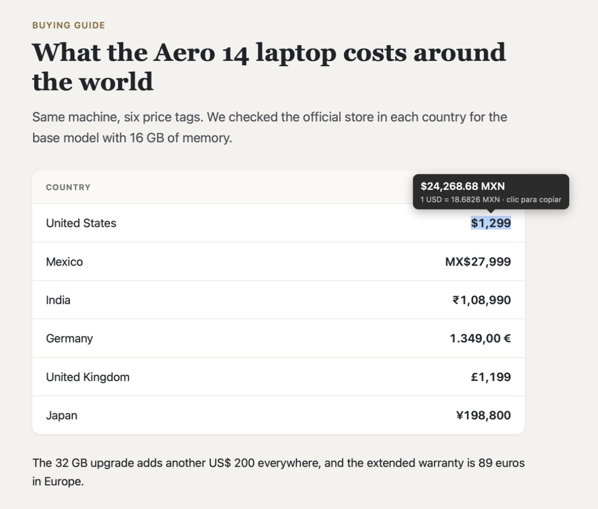
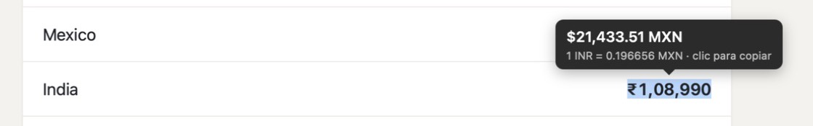
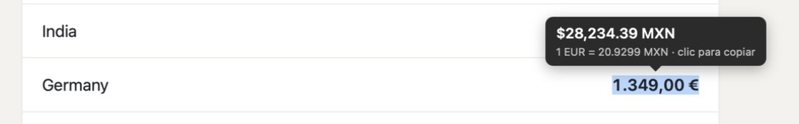
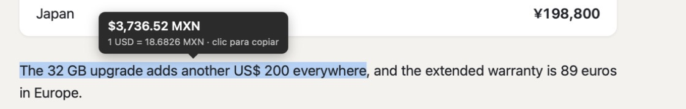
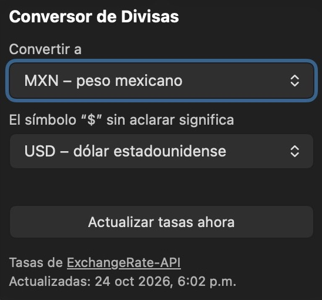

# Conversor de Divisas para Safari

*[Read in English](README.md)*

Extensión de Safari para macOS: selecciona un precio en cualquier página y aparece una pequeña burbuja con la conversión a tu moneda. Dale clic a la burbuja para copiar el monto.

Funciona como la conversión de divisas del menú de selección de Microsoft Edge, sin enviar a ningún servidor lo que lees.

<p align="center">
  
</p>

## Capturas

Tomadas en Safari en español, convirtiendo a pesos mexicanos.

**Rupias con agrupación india**



**Euros en formato europeo**



**Una frase completa: convierte los US$ 200, no los 32 GB**



**Ajustes en el botón de la barra**



## Funciones

- **Selecciona y listo:** selecciona `$119`, `₹8,024.13`, `1.234,56 €` o una línea completa como `Windows 10 Home - $119` y ves la conversión al instante.
- **Clic para copiar:** el monto convertido se copia como número simple (`2223.23`), listo para pegar en una hoja de cálculo.
- **Tu moneda:** eliges la moneda destino desde el botón de la barra (unas 160 monedas). La predeterminada sale de la región de tu navegador.
- **El `$` ambiguo:** eliges qué significa un `$` a secas (USD, MXN, CAD, AUD, ARS, COP…), porque en un sitio mexicano `$` son pesos.
- **Muchos formatos:**
  - Símbolos: `$ US$ MX$ CA$ A$ R$ € £ ¥ ₹ ₩ ₽ ₺ ₱ ₪ ₫ ฿ zł Kč` y más
  - Códigos ISO: `USD 100`, `100 EUR`
  - Palabras en español e inglés: `300 pesos`, `100 dólares`, `20 euros`, `50 dólares canadienses`, `100 dollars`
  - Formatos de número: `1,234.56`, `1.234,56`, `1 234,56`, indio `1,23,456.78`
  - Abreviaturas: `12.5k`, `$5 mil`, `€5M`, `1.5 millones de dólares`
- **Interfaz en español e inglés**, según el idioma de Safari.
- **Privada:** ver [Privacidad](#privacidad).

## Requisitos

- macOS 12 o posterior con Safari 16 o posterior
- Xcode para compilarla (el proyecto se hizo con Xcode 27.1; ver [Compilar con un Xcode anterior](#compilar-con-un-xcode-anterior))

La extensión todavía no está en la App Store, así que la compilas tú. Tarda como un minuto.

## Instalación

1. Clona el repositorio:

   ```bash
   git clone https://github.com/ceolitzin/CurrencyConverter4Safari.git
   cd CurrencyConverter4Safari
   ```

2. Busca tu Team ID de desarrollador de Apple. Si ya iniciaste sesión en Xcode con tu Apple ID (Xcode → Ajustes → Cuentas), es el código de 10 caracteres que aparece aquí:

   ```bash
   security find-certificate -c "Apple Development" -p | openssl x509 -noout -subject
   ```

   Busca `OU=XXXXXXXXXX`.

3. Compila e instala en `/Applications`:

   ```bash
   make install TEAM=XXXXXXXXXX
   ```

   La app se abre una vez para que Safari encuentre la extensión. Puedes cerrarla.

4. En Safari ve a **Ajustes → Extensiones**, activa **Conversor de Divisas** y permítele acceso a todos los sitios (o a los que elijas).

### Sin Apple ID

`make install` sin `TEAM` firma la app solo para tu Mac. Safari carga extensiones firmadas así únicamente mientras **Desarrollo → Permitir extensiones sin firmar** está activado, y apaga esa opción cada vez que cierras Safari. Iniciar sesión en Xcode con un Apple ID gratuito lo evita.

### Compilar con un Xcode anterior

Si tu Xcode no abre `xcode/Currency Converter.xcodeproj`, genera un proyecto nuevo a partir del código de la extensión:

```bash
xcrun safari-web-extension-converter extension --macos-only --app-name "Currency Converter" \
  --bundle-identifier com.tunombre.CurrencyConverter --project-location /tmp/cc
```

Después compílalo y ejecútalo desde Xcode, eligiendo tu equipo en **Signing & Capabilities** en los dos targets.

## Uso

- Selecciona un precio con el mouse (o con Shift y las flechas). La burbuja aparece sobre la selección.
- Dale clic a la burbuja para copiar el monto convertido.
- Presiona Esc, haz clic en otro lado o desplázate para cerrarla.
- Con el botón de la barra cambias la moneda destino, eliges qué significa `$` o actualizas las tasas.

Si la selección tiene varios números, se convierte el que está junto a un símbolo, código o nombre de moneda. Las selecciones de más de 80 caracteres se ignoran.

## Tasas de cambio

Las tasas vienen del servicio abierto de [ExchangeRate-API](https://www.exchangerate-api.com), con [Frankfurter](https://frankfurter.dev) (tasas de referencia del Banco Central Europeo) como respaldo. Ambos se actualizan una vez al día. La extensión las guarda 6 horas y, sin conexión, sigue usando las últimas que tenga.

Las tasas son de referencia. Tu banco o tarjeta usará su propio tipo de cambio.

## Privacidad

- El texto seleccionado se lee y se analiza solo dentro de la página, en tu Mac.
- Las únicas peticiones de red son para descargar las tablas de tasas de los dos servicios de arriba, y nunca incluyen nada de las páginas que visitas.
- Los ajustes y las tasas se guardan localmente en Safari. No hay analíticas ni cuentas.

Ver [PRIVACY.md](PRIVACY.md).

## Desarrollo

```
extension/          Código de la extensión web (Manifest V3)
  parser.js         Encuentra el monto y la moneda en el texto seleccionado
  content.js        Manejo de la selección y la burbuja
  background.js     Descarga y guarda las tasas, convierte
  popup.html/js     Ventana del botón de la barra con los ajustes
  _locales/         Textos en inglés y español
tests/              Pruebas del reconocedor (test runner integrado de Node)
xcode/              App contenedora para macOS generada con safari-web-extension-converter
```

El proyecto de Xcode apunta directamente a los archivos de `extension/`, así que solo hay una copia del código.

```bash
npm test        # o: make test   (Node 18 o posterior, sin dependencias)
make build TEAM=XXXXXXXXXX
```

Después de cambiar la extensión, vuelve a correr `make install` y recarga la página en Safari. Para depurar, activa **Ajustes → Avanzado → Mostrar funciones para desarrolladores web** y usa **Desarrollo → Web Extension Background Content** para el script de fondo y el Web Inspector normal para el content script.

Los reportes de errores y pull requests son bienvenidos; ver [CONTRIBUTING.md](CONTRIBUTING.md). Si algún formato de precio no se reconoce, [abre un issue](https://github.com/ceolitzin/CurrencyConverter4Safari/issues/new/choose) con el texto exacto que seleccionaste. Los cambios están en [CHANGELOG.md](CHANGELOG.md).

## Licencia

[MIT](LICENSE)
